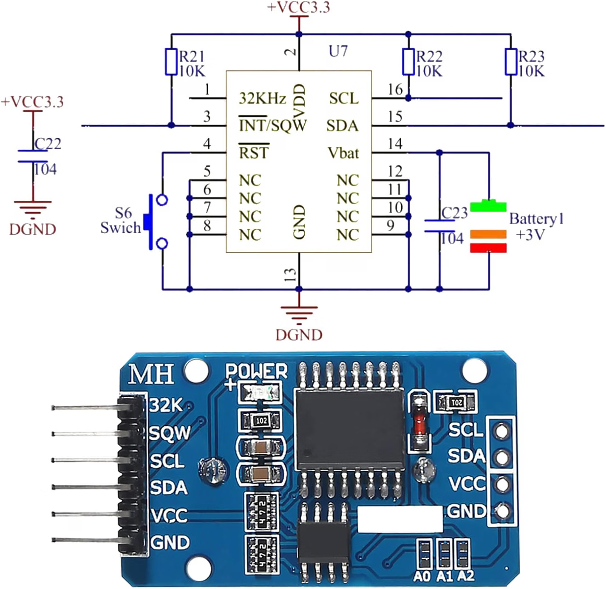
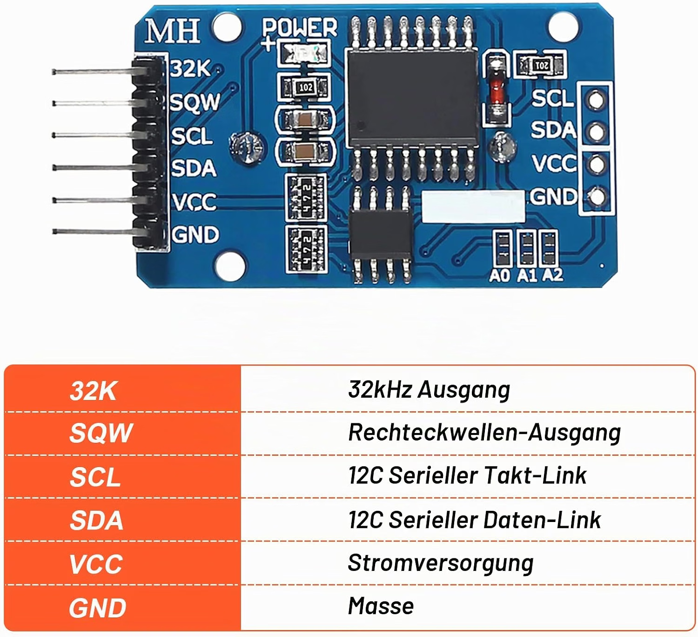

# DS3231 RTC module: integration reference

Status: planned replacement for the [DS1302 RTC](ds1302.md). The FPGA design
and EmuTOS driver still use the DS1302; this document does not imply DS3231
hardware or software support is implemented. Work starts on `ds3231-integration`.

## Module documentation

The purchased module was advertised as “AT24C32 Clock Module, Real Time Clock
RTC IIC RTC Module for Arduino”. The user supplied the following vendor images
and specifications on 2026-11-24. The images are stored in this repository;
no external image hosting or manual copying is needed.

The supplied schematic shows the RTC, but omits the AT24C32 and other circuitry
visible in the board photograph. Treat it as a reference, not a verified full
schematic of the purchased board; check component values and connections on
that board before relying on them.

## Specifications and corrections

| Item | Module listing / chip specification |
| --- | --- |
| Advertised module size | 38 x 22 x 14 mm; approximately 7 g |
| RTC | DS3231 with integrated temperature-compensated oscillator and crystal |
| Module supply listing | 3.3–5.5 V; use **3.3 V** with RT68ICE |
| Timekeeping accuracy | ±2 ppm from 0–40°C, approximately ±63 seconds per year |
| Temperature reading | ±3°C specified accuracy; useful as a rough local temperature reading |
| Calendar | Seconds, minutes, hours, day, date, month and year; leap-year compensation through 2100 |
| Interface | I²C, up to 400 kHz; initial bring-up target: 100 kHz |
| Backup | Battery-backed timekeeping when main power is absent |
| Additional functions | Two alarms, square-wave output, 32.768 kHz output and reset function |
| Additional memory | AT24C32: **32 Kbits = 4 KiB EEPROM**, not the listing's “32 KB” and not serial flash |

The listing gives the EEPROM's default I²C address as `0x57`, configurable with
A0/A1/A2. This is the EEPROM address, not the RTC address; verify it on the actual
module if EEPROM support is added. The EEPROM is not needed for initial RTC use.

Primary references:

- [Analog Devices DS3231 specifications and datasheet](https://www.analog.com/en/products/ds3231.html)
- [Microchip AT24C32 family reference (AT24C32E)](https://www.microchip.com/en-us/product/AT24C32E)
  — confirm the exact EEPROM suffix fitted to the module before using its
  detailed electrical or timing limits.

## Initial wiring

Power off before changing connections. The DS3231 is not pin- or
protocol-compatible with the DS1302; do not substitute it into the old wiring.
FPGA pin assignments and constraints remain to be selected.

| Module pin | Initial RT68ICE connection |
| --- | --- |
| VCC | 3.3 V supply |
| GND | Common ground |
| SCL | FPGA I²C clock pin, assignment pending |
| SDA | FPGA bidirectional I²C data pin, assignment pending |
| SQW | Leave unconnected; alarms are deferred |
| 32K | Leave unconnected; clock output is deferred |

The opposite four-pin header is labelled SCL, SDA, VCC and GND. It is expected
to duplicate the main header for connecting another I²C device; confirm with an
unpowered continuity check rather than treating it as a second interface.
The listing's Arduino A4/A5 assignments are not RT68ICE FPGA pin assignments.

### Pull-ups and voltage levels

In the supplied schematic, R21, R22 and R23 are 10 kΩ pull-ups from INT/SQW,
SCL and SDA respectively to VCC3.3. If the actual board follows this circuit,
powering it from 3.3 V gives 3.3 V pull-ups; no extra pull-ups are initially
needed. The photograph is not sufficient to verify all resistor values or
connections. Confirm the actual board's pull-ups and idle bus voltage.
Do not power the module at 5 V with pull-ups to 5 V connected directly to FPGA
pins. FPGA I²C outputs must pull the bus low or release it, rather than actively
driving it high. Keep initial wiring short and use a common ground.

### Battery circuit

The reference schematic shows a 3 V battery directly connected to VBAT and
no charging path, but it does not document all components on the photographed
module. Establish whether the actual board includes a charging circuit before
fitting a non-rechargeable CR2032. A seller's module photograph alone does not
confirm battery compatibility.

## Integration scope

1. Select FPGA pins, confirm 3.3 V wiring and implement the I²C interface.
2. Add a standalone diagnostic to read/set time, read temperature, and check
   battery retention across power-off. Verify the RTC's oscillator-stop status
   so invalid time is not silently treated as valid.
3. Update EmuTOS RTC access for the DS3231 register layout and I²C transactions,
   retaining the existing application-facing date/time services.
4. Validate normal boot, time setting, advancing time and power-cycle retention.

Alarm interrupts/SQW, the 32K output and AT24C32 support are deferred. The
existing DS1302 register map is documented separately; it is not a DS3231
register map. No new FPGA memory map or pin assignment is committed by these
reference documents.
